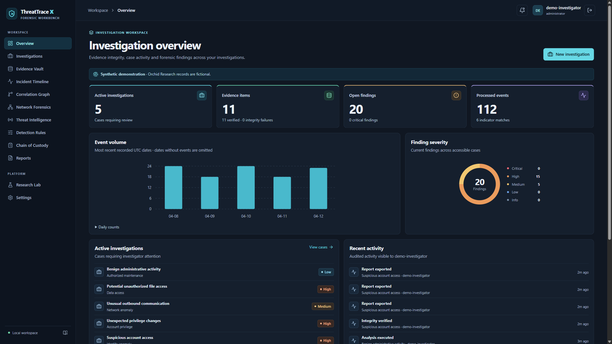
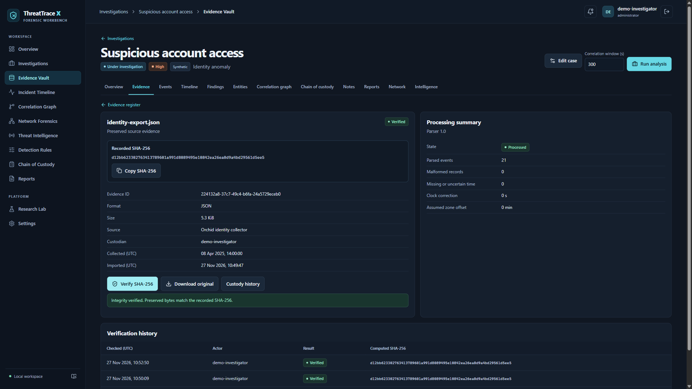
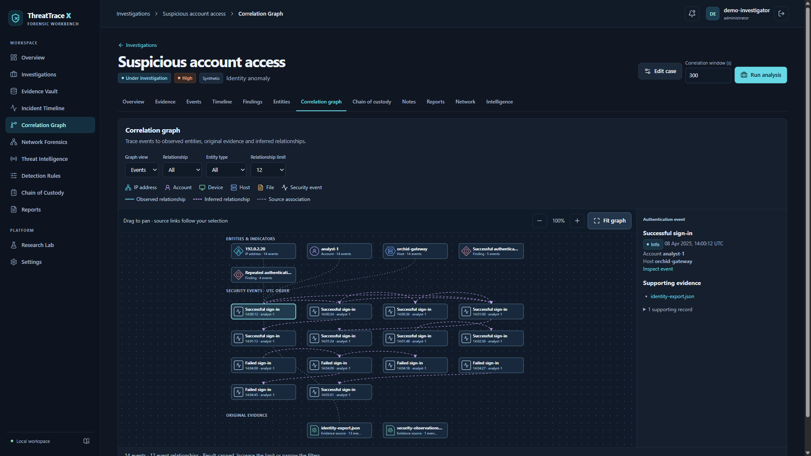
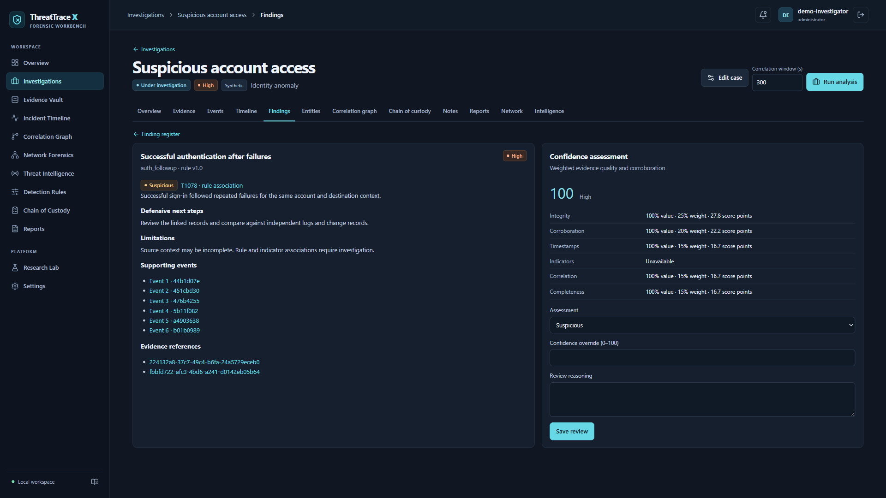
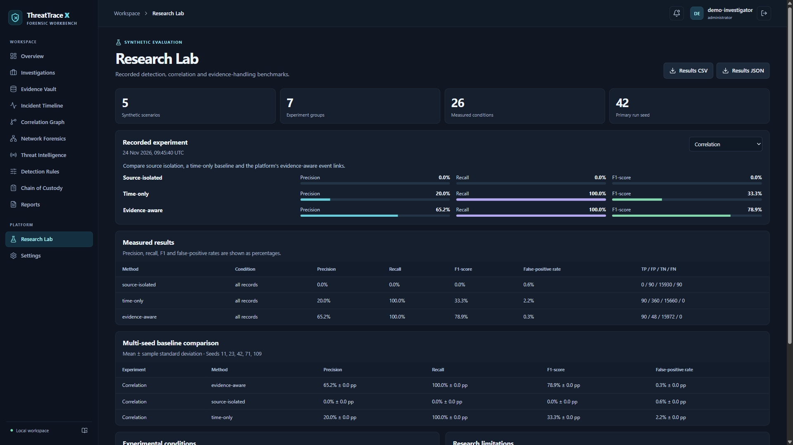
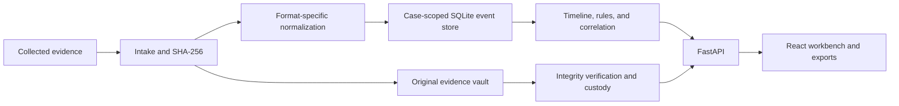

# ThreatTrace X

[](https://github.com/Faizan-AiEngineer/threattrace-x/actions/workflows/verify.yml) [](LICENSE)

ThreatTrace X is a local digital forensics, incident reconstruction, and threat intelligence workbench. It helps investigators reconstruct activity from collected logs and offline network captures while retaining the original evidence and showing how individual records support a finding.

## Investigations it supports

An incident can leave evidence across identity logs, endpoint events, and network telemetry. Different clocks, missing records, and repeated benign activity make it difficult to build a reliable timeline. ThreatTrace X brings those records into a case, preserves the source bytes, and makes it possible to trace an assessment back to the supporting evidence.

| Who | Practical use |
| --- | --- |
| Incident responders and security analysts | Reconstruct a suspicious sign-in, privilege change, file access, or unusual outbound flow. |
| Digital forensics practitioners | Verify preserved evidence, inspect custody records, and export a documented case summary. |
| Educators, students, and researchers | Replay five synthetic scenarios and compare evidence-aware detection and correlation with recorded baselines. |

## Investigation capabilities

- **Case management** tracks scope, severity, status, investigator notes, access grants, and audited actions.
- **Evidence preservation** retains exact source bytes, records SHA-256 and collection context, and verifies the hash-linked custody history.
- **Incident reconstruction** normalizes supported logs and offline packet captures, preserves source references and timestamps, and applies the same search and filters to the timeline and its CSV export.
- **Detection and correlation** provide rule findings, transparent confidence components, analyst review, and an interactive graph that distinguishes observed from inferred event relationships.
- **Network forensics and threat intelligence** summarize case traffic and link exact matches against case-local indicators back to their events.
- **Reporting and research** provide PDF, HTML, JSON and CSV exports, plus recorded experimental comparisons, conditions and limitations.

## Application walkthrough

All five 1920 × 1080 captures use the fictional Orchid Research cases. [Complete screenshot gallery](docs/release-2026-11-27/RELEASE-VERIFICATION.md#screenshot-gallery)

### 1. Security overview



*Review workload, evidence integrity, finding severity, and recorded event volume across accessible cases.*

### 2. Evidence integrity



*Recompute SHA-256 on the preserved source file and inspect the resulting verification record.*

### 3. Correlation graph



*Trace events to observed entities and original evidence. Solid and dashed relationships distinguish observations from inferences.*

### 4. Finding confidence



*See the reasoning and evidence behind a finding before recording an analyst assessment.*

### 5. Research benchmarks



*Compare the recorded source-isolated, time-only, and evidence-aware baselines and inspect the five-seed summary.*

## Installation and local demonstration

Use Windows, PowerShell, Python 3.13, Node.js 22.12 or later, Git, and a current browser. Docker and a live-capture driver are unnecessary for the included fixtures.

```powershell
git clone https://github.com/Faizan-AiEngineer/threattrace-x.git
Set-Location threattrace-x
.\scripts\setup.ps1
.\scripts\start-demo.ps1
```

Choose a unique demo-only password of at least 12 characters when prompted, then open **[the workbench](http://127.0.0.1:5173/)** and sign in as **`demo-investigator`**. Each installation chooses its own password. The launcher uses a dedicated `runtime/demo` SQLite database and evidence vault, and the demo backend restricts browser origins and clients to loopback. Keep the demo on your workstation. Use a separate data directory and a separate local account for authorized evidence. [Security and demo isolation](SECURITY.md)

1. Open **Suspicious account access** under Investigations.
2. Select **Evidence → identity-export.json**, run **Verify SHA-256**, then open **Custody history**.
3. Open **Timeline**, filter by **Account**, and export the matching events.
4. Review **Findings** and **Correlation graph**, then follow an assessment back to an original file.
5. Open **Unusual outbound communication** for offline network summaries and exact indicator matches. Export an HTML or PDF report under **Reports**.

To start a separate local case workspace with no seeded data, set `TTX_DATA_DIR` to a fresh private folder, run `.\scripts\seed-demo.ps1 -AdminOnly -Username <local-admin>`, then run `.\scripts\start-all.ps1` in the same PowerShell session. The demo launcher does not open that profile. [User guide](docs/user-guide/README.md)

## Architecture and stack



| Layer | Technology |
| --- | --- |
| Workbench | React, TypeScript, Vite, Lucide |
| API and validation | Python 3.13, FastAPI, Pydantic |
| Local storage | SQLite, SQLAlchemy Core, Alembic, filesystem evidence vault |
| Analysis and reporting | Offline Scapy parsing, NetworkX correlation, ReportLab PDF |
| Verification | pytest, Playwright, GitHub Actions |

See the [architecture](ARCHITECTURE.md), [data dictionary](DATA_DICTIONARY.md), and [threat model](THREAT_MODEL.md) for the storage and trust boundaries.

## API documentation

With the application running on its default ports, open [Swagger UI](http://127.0.0.1:8000/docs) or the [OpenAPI schema](http://127.0.0.1:8000/openapi.json). v0.2.0 documents 51 operations under ten categories. The API uses an HTTP-only local session cookie. Protected calls require a valid session and write requests require `X-TTX-Request: 1`. Examples use placeholders and synthetic values. [API guide](docs/api/README.md)

## Recorded research and benchmarks

The following metrics come from the saved seed-42 synthetic experiment. The suite covered five detection scenarios and an event-pair fixture containing 90 labeled positive pairs and 16,020 negatives.

| Task | Method | Precision | Recall | F1 |
| --- | --- | ---: | ---: | ---: |
| Case/rule detection | Platform rules | 0.818 | 1.000 | 0.900 |
| Case/rule detection | Independent sources | 0.889 | 0.889 | 0.889 |
| Event-pair correlation | Source-isolated | 0.000 | 0.000 | 0.000 |
| Event-pair correlation | Time-only | 0.200 | 1.000 | 0.333 |
| Event-pair correlation | Evidence-aware | 0.652 | 1.000 | 0.789 |

Platform detection recovered one additional case/rule label and added one false positive. Evidence-aware correlation recovered all 90 labeled pairs and produced 48 false-positive links. Five replay seeds returned the same baseline scores under closely related fixture templates. The 100,000-record synthetic run took **85.90 seconds**, including **20.05 seconds** for correlation. The timing includes Python allocation tracing and excludes storage writes, HTTP, and rendering. These results characterize the recorded fixtures. [Benchmarks](BENCHMARKS.md) · [Methodology](research/README.md) · [Original JSON](research/results/results.json) · [Five-seed replay](research/results/multi-seed.json)

## Testing and verification

```powershell
.\scripts\run-tests.ps1
```

The release passed **31 backend tests and eight Playwright tests in installed Google Chrome**, plus the frontend production build, type checking, and linting. The Chrome walkthrough exercised investigation routes, evidence verification, filtered exports, graph controls, case isolation, and access administration. The dependency audits and secret scans are recorded in the [release verification](docs/release-2026-11-27/RELEASE-VERIFICATION.md). [GitHub Actions](https://github.com/Faizan-AiEngineer/threattrace-x/actions/workflows/verify.yml) · [Changelog](CHANGELOG.md)

## Known limitations and roadmap

- **Local deployment.** The supported profile uses loopback and SQLite on a trusted workstation. Shared deployment would require transport security, authentication rate limits, centralized identity, protected storage and backups, and concurrent-load validation.
- **Custody trust.** Verification checks the chain against its stored head and count. Independent timestamping or a separately controlled audit anchor would improve resistance to coordinated storage changes.
- **Detection scope.** Input parsers and graph size are bounded. Confidence scores are heuristics, and offline traffic visibility depends on the capture. Follow-up work includes broader input sets, richer graph navigation, and more diverse benchmark fixtures.
- **Accessibility and collaboration.** Release testing covers Chrome and selected keyboard and responsive paths. Further work includes assistive-technology coverage, cross-browser checks, and additional review workflows.

[MIT License](LICENSE)
