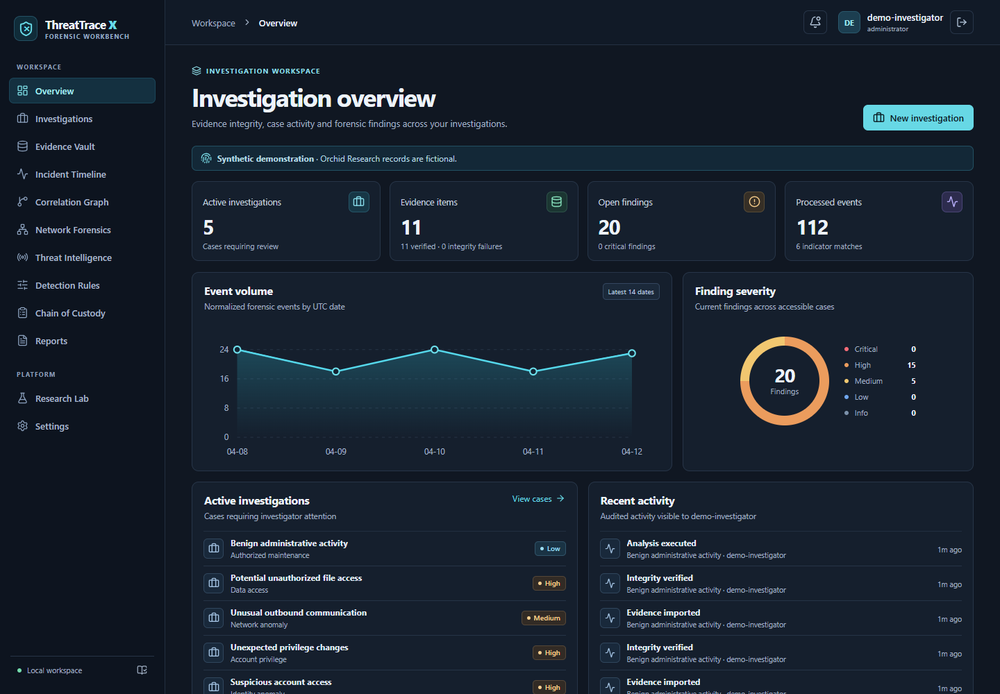
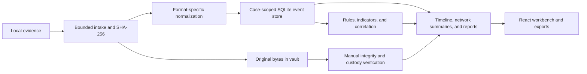

# ThreatTrace X

**Digital Forensics, Incident Reconstruction and Threat Intelligence Platform**

Investigate. Reconstruct. Verify.

ThreatTrace X is a Windows-native SQLite research prototype and forensic workbench for tracing findings through normalized events to the original evidence. It stores exact source bytes, records evidence handling, and helps investigators reconstruct activity across logs and offline packet captures.



## Windows quick start

Requirements are Python 3.13, Node.js 22.12 or later (24 verified), Git, PowerShell and a browser. Existing installations are reused. The setup script keeps the virtual environment and node_modules inside the project and puts npm, Python caches, and temporary files under D:\ThreatTraceTools. Docker and packet capture drivers are unnecessary.

```powershell
Set-Location -LiteralPath 'D:\Github Projects\ThreatTrace-X'
.\scripts\check-storage.ps1
.\scripts\setup.ps1
.\scripts\seed-demo.ps1
.\scripts\start-all.ps1
```

Choose a password at the prompt and sign in as **demo-investigator**. Repeat the seed command with the same password and seed to reuse the same cases. For an empty workspace, use `seed-demo.ps1 -AdminOnly -Username <name>` in a fresh data directory. Run backend and frontend in separate terminals with `start-backend.ps1` and `start-frontend.ps1`. The frontend script also accepts `-Preview -Port 4173` to serve a local production build.

| Service | Local address |
| --- | --- |
| Workbench | [127.0.0.1:5173](http://127.0.0.1:5173/) |
| Backend | [127.0.0.1:8000](http://127.0.0.1:8000/) |
| OpenAPI | [127.0.0.1:8000/docs](http://127.0.0.1:8000/docs) |

## Investigate a case

1. Open **Suspicious account access** in Investigations and inspect the case scope.
2. Open **Evidence**, select **identity-export.json**, and verify its SHA-256 hash. Open custody history to inspect the linked records.
3. Open **Timeline** and filter by category, evidence file, host, account, severity or UTC range. Open an event to inspect the original timestamp, corrected time, metadata, and source anchor.
4. Run analysis with the case correlation window. Review a finding, follow its supporting events back to evidence, and document the assessment.
5. Open **Unusual outbound communication** to see packet metadata, flows, DNS, and matches against a reserved synthetic indicator.
6. Export a PDF, HTML, JSON, event CSV, or findings CSV from **Reports**. See [the case study](CASE_STUDY.md) and [screenshots](docs/screenshots/README.md) for the full demonstration.

## Architecture



FastAPI and Pydantic define the API. SQLAlchemy Core and Alembic manage SQLite. Scapy reads offline captures, NetworkX stores candidate relationships, and ReportLab renders PDF. The UI uses React, TypeScript, Vite and Lucide. The [architecture](ARCHITECTURE.md), [data dictionary](DATA_DICTIONARY.md) and [API guide](docs/api/README.md) document the implementation.

## Verification and research

```powershell
.\scripts\run-tests.ps1
.\scripts\run-research.ps1 -Seed 42
```

The tests use generated local data and a disposable case database. The research runner writes measured CSV, JSON and SVG figures. The **Research Lab** reads those results. Across five deterministic seeds, combined detection reached mean F1 **0.900** and evidence-aware pair correlation reached **0.789**. The seed variations leave template structure and decision-relevant thresholds largely unchanged. [Individual results](research/results/multi-seed.json) See [benchmarks](BENCHMARKS.md) and [methodology](research/README.md) for denominators, baselines and interpretation.

## Scope and limitations

The supported deployment is a trusted Windows workstation with services on loopback. Restrict access to the vault and database using OS permissions. The custody chain detects edits and omissions relative to its recorded head and count. A party with write access to both records and the head can replace them together. Analysts should corroborate rule associations and heuristic scores before reaching conclusions. Offline capture visibility depends on captured headers and encryption. Format coverage, scale limits and release gaps are listed in [security](SECURITY.md), [the threat model](THREAT_MODEL.md) and the [development report](DEVELOPMENT_REPORT.md).

## Repository

| Location | Contents |
| --- | --- |
| backend | FastAPI application, Alembic migration, and pytest suite |
| frontend | React workbench, Playwright tests, and screenshot capture |
| datasets | Synthetic generator instructions |
| research | Methodology, measured CSV and JSON, and figures |
| docs | API, investigator workflow, architecture notes, and screenshots |
| scripts | Windows setup, run, seeding, verification, research, and storage commands |

[MIT License](LICENSE)
